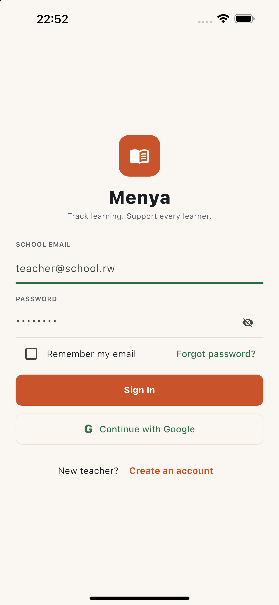
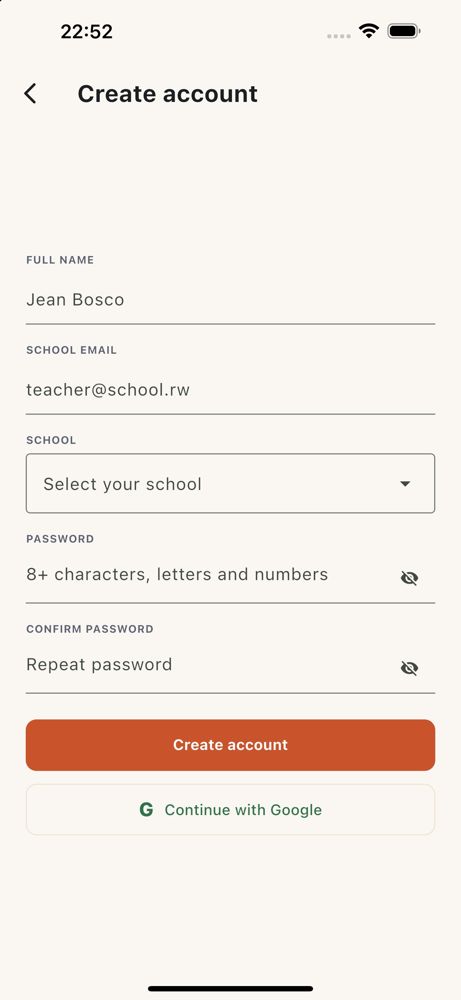
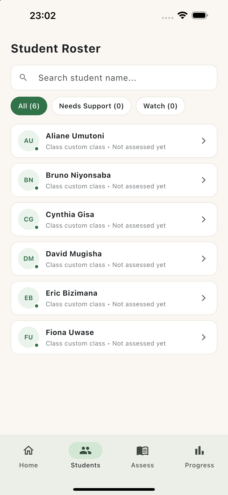
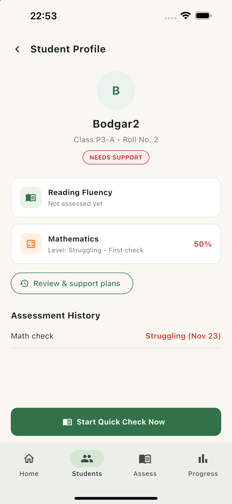
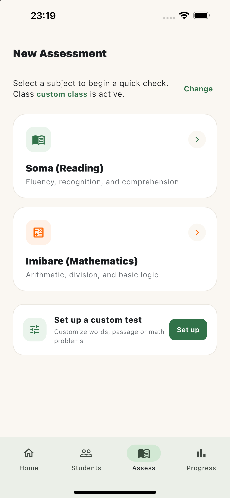
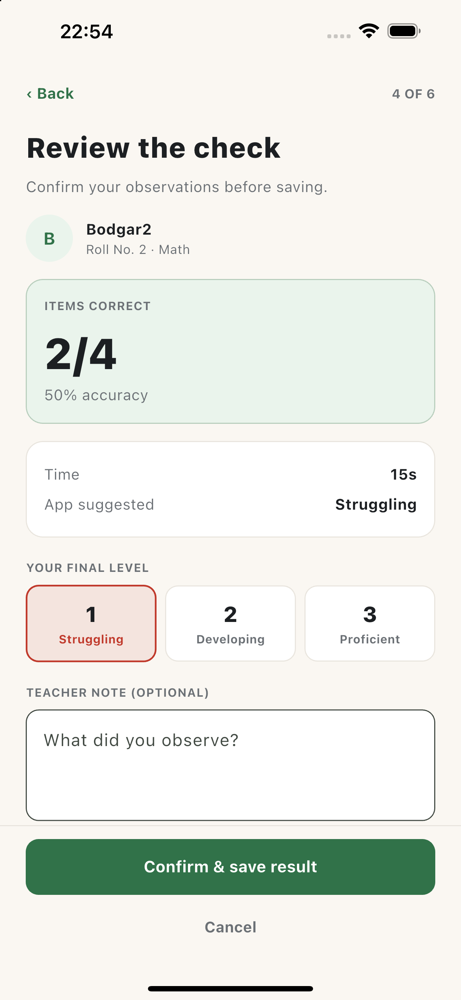
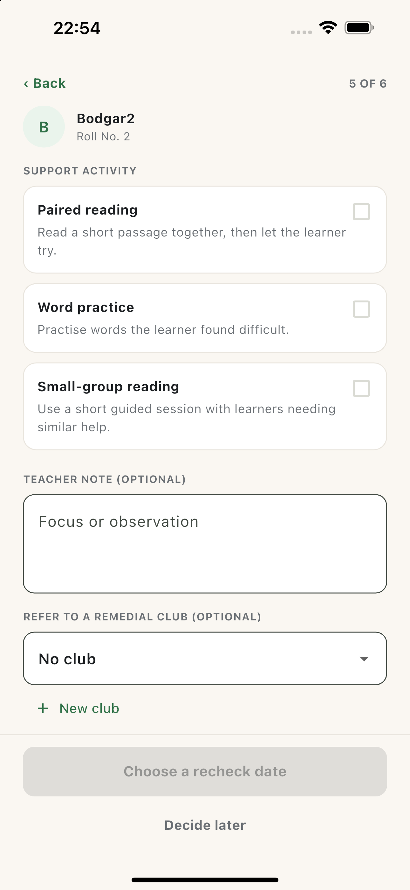
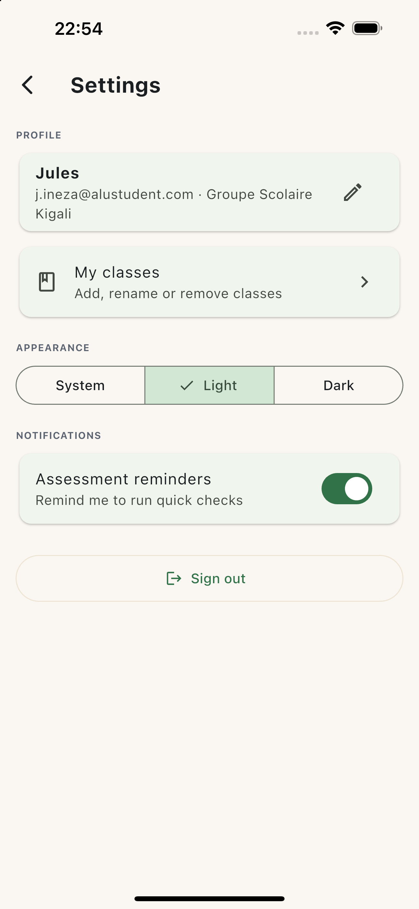

# Menya

Menya is a Flutter mobile app that helps primary school teachers run quick reading and math checks with their learners, review the results, and plan follow-up support. Data is stored in Cloud Firestore and users sign in with Firebase Authentication.

Repository: https://github.com/julesineza/mobile_dev_summative_menya

## Features

- **Authentication**: register and log in with email and password or with Google. Includes email verification, password reset and logout. The login state is kept after the app restarts.
- **Dashboard**: summary of the teacher's classes and recent quick checks.
- **Classes and students**: create, view, edit and delete classes and students. The student roster has search and status filters, and each student has a profile page.
- **Assessments**: set up reading or math tests, select a class and learners, run the test and save the results.
- **Review and support**: review a result, pick a support activity, refer a learner to a remedial club, schedule a recheck date and view the learner's history.
- **Class progress**: a breakdown of learners by status for each class.
- **Settings (saved with SharedPreferences)**: theme mode (light or dark), active class, timer mode, preferred language and haptic feedback. All of them are restored when the app is relaunched.

## Tech Stack

| Area | Choice |
|---|---|
| Framework | Flutter (Dart SDK ^3.13) |
| State management | Provider (`ChangeNotifier`) |
| Navigation | go_router |
| Backend | Cloud Firestore |
| Authentication | Firebase Auth (email/password and Google) |
| Local preferences | shared_preferences |
| Testing | flutter_test and mocktail |

## Project Structure

The code is split into layers. The UI never talks to Firebase directly: screens call providers, and providers call services.

```
lib/
  main.dart            App entry point: starts Firebase, loads preferences, registers providers
  app_routes.dart      All routes and auth redirects (go_router)
  firebase_options.dart
  core/                Shared helpers: validators, error handling, Firestore paths, theme, colours
  models/              Data classes that map to Firestore documents
  services/            Data layer: all Firestore, Auth and SharedPreferences calls
  providers/           State layer: ChangeNotifier classes that hold screen state and business logic
  screens/             Presentation layer, one folder per feature
    auth/  dashboard/  students/  progress/  assessment/  review/  settings/
  widgets/             Reusable widgets shared across screens
test/                  Unit and widget tests, grouped the same way as lib/
firestore.rules        Firestore security rules
firestore.indexes.json Firestore composite indexes
seed/schools.json      Starter school records for the register screen
```

### State management

The app uses Provider. Each feature has a `ChangeNotifier` provider (for example `AuthProvider`, `StudentProvider` and `ReviewProvider`) that holds the loading, error and data state and calls the matching service. Screens read the state with `context.watch` or `context.select` and rebuild only when it changes. All providers are registered in one place, `lib/providers/app_providers.dart`.

### Code quality

- Firestore calls are wrapped in one shared function (`guardFirebase` in `lib/core/firebase_guard.dart`). It turns Firebase errors into friendly messages that are shown in a snackbar.
- Collection names live only in `lib/core/firestore_paths.dart`.
- Form checks are reusable functions in `lib/core/validators.dart`.
- Each file starts with a comment that names its owner and purpose. Comments also explain the parts of the code that are not obvious.

## Database

Firestore collections:

| Collection | Purpose | Links |
|---|---|---|
| `schools` | Schools a teacher can join | none |
| `users` | Teacher profile (name, email, schoolId) | `schoolId` points to `schools`; the document ID is the Auth uid |
| `classes` | A teacher's classes | `teacherId` points to `users`, `schoolId` points to `schools` |
| `students` | Learners | `classId` points to `classes`, `schoolId` points to `schools` |
| `tests` | Custom reading or math tests | `schoolId` |
| `assessments` | One assessment session | `classId`, `schoolId` |
| `assessmentResults` | A learner's result for an assessment | `studentId`, `schoolId` |
| `supportPlans` | Support activity and recheck date for a result | `studentId`, `schoolId` |
| `remedialClubs` | Remedial clubs in a school | `schoolId` |
| `clubEnrollments` | A learner's membership in a club | `studentId`, `clubId`, `schoolId` |

### Security rules

The rules in `firestore.rules` follow these principles:

- **Users**: a teacher can only read and edit their own profile. They can only change the `name` and `schoolId` fields.
- **Classes**: a class can only be read or changed by the teacher whose ID is in `teacherId`.
- **School data**: students, tests, assessments, results, plans, clubs and enrollments can only be read or written by teachers in the same school. A document's `schoolId` cannot be changed.
- **Schools**: the school list is read-only, because the register screen needs it before the user has an account.
- **Everything else**: any other path is denied.

## Setup

### Requirements

- Flutter SDK (stable channel) with Dart 3.13 or later
- Android Studio with an Android emulator (API 23 or higher), or a physical Android phone with USB debugging enabled
- Xcode, only if you want to run the app on iOS

### Run the app

1. Clone the repository:
   ```
   git clone https://github.com/julesineza/mobile_dev_summative_menya.git
   cd mobile_dev_summative_menya
   ```
2. Install the packages:
   ```
   flutter pub get
   ```
3. Start an emulator or connect a phone, then check that Flutter can see it:
   ```
   flutter devices
   ```
4. Run the app:
   ```
   flutter run
   ```
5. To build a release APK, run the command below. The APK is written to `build/app/outputs/flutter-apk/app-release.apk`.
   ```
   flutter build apk --release
   ```

The Firebase configuration is already in the repository (`android/app/google-services.json`, `ios/Runner/GoogleService-Info.plist` and `lib/firebase_options.dart`), so no extra setup is needed to connect to the team's Firebase project.

### Using your own Firebase project (optional)

1. Create a Firebase project and enable **Email/Password** and **Google** sign-in under Authentication.
2. Create a Cloud Firestore database.
3. Run `flutterfire configure` to generate new config files for Android and iOS.
4. For Google sign-in on Android, add your debug SHA-1 in the Firebase console. You can print it with:
   ```
   keytool -list -v -keystore ~/.android/debug.keystore -alias androiddebugkey -storepass android -keypass android
   ```
5. Deploy the rules and indexes:
   ```
   firebase deploy --only firestore:rules,firestore:indexes
   ```
6. Add at least one school to the `schools` collection. You can use the records in `seed/schools.json`. Users can't register until a school exists.

## Testing and Code Quality

Run the tests:

```
flutter test
```

The test suite covers:

- **Unit tests**: validators, date labels, support options, and the auth, class, settings, student, assessment and review providers. The student service is also tested.
- **Widget tests**: the login screen, assessment screens, student roster and profile, class progress, the support plan and review flow screens, and the shared student widgets.
- **Integration-style test**: the assessment flow, run through its provider.

Format the code and check it for issues:

```
dart format lib test
flutter analyze
```

## Screenshots

### flutter analyze


### flutter test


### App

| Sign in | Register | Home |
|---|---|---|
|  |  |  |

| Student roster | Student profile | Assessment |
|---|---|---|
|  |  |  |

| Review the check | Support plan | Settings |
|---|---|---|
|  |  |  |

## Team

| Member | Area |
|---|---|
| Divine Mutesi (Member 1) | Authentication, dashboard, settings, Firestore rules |
| Nawaf Ahmed (Member 2) | Student roster, student profile, class progress |
| Ineza Jules (Member 3) | Project setup, assessments module, integration |
| Bodgar Kwizera (Member 4) | Review result, support plan, recheck and learner history |
